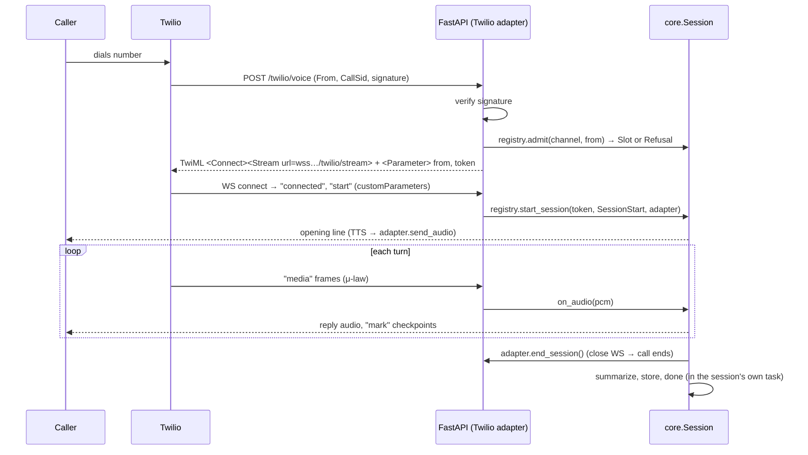
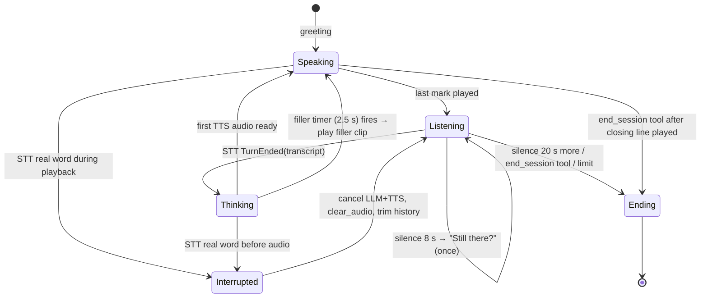

# Voice Agent — Technical Design (v0)

Status: draft for v0 · Last updated: 2026-11-17 (build step 3 done)
The product spec (use cases, decisions, settings) is kept separately and is the source of truth for *what*; this doc covers *how*. Spec references such as "D30" or "UC-8" point to it.

This document turns the product spec into code structure. When the two disagree, the spec wins and this doc gets fixed.

---

## 1. Decisions this design rests on

| Area | Choice |
| --- | --- |
| Language / runtime | Python 3.13, asyncio throughout (3.13 because `audioop-lts` needs it) |
| Packaging | `uv` (Python version, deps, lockfile) |
| Web framework | FastAPI + uvicorn (single worker — see §14) |
| Voice pipeline | Custom, no framework. Cascaded STT → LLM → TTS |
| STT | Deepgram Flux (streaming, turn detection built in), over a raw WebSocket |
| LLM | Claude Haiku 5.5 (`claude-haiku-5-5`) via the official `anthropic` Python SDK |
| TTS | Cartesia Sonic 3.6 over a raw WebSocket (streaming, cloned voice with stock fallback) |
| Channel (v0) | Twilio Programmable Voice + bidirectional Media Streams |
| Database | SQLite via `aiosqlite`, hand-written SQL, numbered migration files |
| Admin UI | Server-rendered Jinja2 templates in the same FastAPI app, plain CSS |
| Email | Gmail SMTP (app password) via stdlib `smtplib` in a worker thread |
| Tests | `pytest` + `pytest-asyncio`; lint/format with `ruff` |

---

## 2. Dependency rule (the one rule that matters)

```
app (FastAPI wiring, startup)
 ├── adapters/        Twilio today, web later      ─┐
 ├── providers/       Deepgram, Anthropic, Cartesia │  all depend on core.interfaces,
 ├── storage/         SQLite                        │  never on each other
 ├── notify/          Gmail                        ─┘
 └── core/            sessions, turn-taking, prompts, tools
       └── interfaces.py   Protocols every outer piece implements
```

- `core/` imports **nothing** from `adapters/`, `providers/`, `storage/` or `notify/`, and no vendor SDK. It only knows the Protocols in `core/interfaces.py`.
- Outer pieces are created in `app/main.py` and injected into the core.
- This applies to providers as well as channels. Swapping Cartesia or Deepgram is the same kind of change as adding the web channel, and tests run the whole core on fakes.
- `tests/unit/test_core_imports.py` enforces this: it parses every file in `core/` (imports inside functions and relative imports included) and fails unless each import is the standard library or `voice_agent.core.*`. It runs with every `pytest`.

---

## 3. Repository layout

```
voice_agent/
├── pyproject.toml / uv.lock
├── .env.example                 # every secret, no values
├── agent.config.yaml            # owner-editable settings (spec: Product variables)
├── kb/                          # knowledge base (spec: Knowledge base); gitignored, private
│   ├── profile.md  status.md  experience.md  skills.md  faq.md  boundaries.md
│   └── projects/*.md
├── kb.example/                  # same layout, made-up content; used by tests
├── assets/audio/                # generated clips: apology, fillers, busy (PCM16)
├── migrations/                  # 0001_init.sql, 0002_…sql
├── scripts/
│   ├── generate_clips.py        # render clips with the current voice_id
│   └── try_pipeline.py          # dev: real Flux → Claude → Cartesia, no phone; timings + WAVs
├── src/voice_agent/
│   ├── app/
│   │   ├── main.py              # FastAPI app, startup wiring, routes mounting
│   │   ├── config.py            # Settings (.env) + AgentConfig (yaml) + constants
│   │   └── constants.py         # spec: "Constants in code (v0)"
│   ├── core/
│   │   ├── interfaces.py        # ChannelAdapter, SessionCallbacks, STT/LLM/TTS, Storage, Notifier
│   │   ├── session.py           # Session: one call: inbox loop, barge-in, timers, storage
│   │   ├── registry.py          # admission + caps, stream tokens, live sessions, shutdown
│   │   ├── turn.py              # one agent turn: LLM stream → sentences → TTS → audio
│   │   ├── sentences.py         # streaming sentence splitter
│   │   ├── speech.py            # what the caller hears: <spell> tags → letters
│   │   ├── bargein.py           # backchannel filter
│   │   ├── history.py           # conversation history + trimming on interruption
│   │   ├── prompt.py            # system prompt assembly (KB + instructions + session context)
│   │   ├── prompts/instructions.md  # block 1 of the system prompt
│   │   ├── tools.py             # save_message, save_caller_details, end_session + handlers
│   │   ├── greeting.py          # opening line, warm intro, name question
│   │   └── clips.py             # loads + checks apology and filler clips (busy is served by Twilio)
│   ├── adapters/
│   │   └── twilio/
│   │       ├── routes.py        # POST /twilio/voice, /twilio/fallback, WS /twilio/stream
│   │       ├── adapter.py       # TwilioAdapter implements ChannelAdapter
│   │       ├── audio.py         # μ-law ↔ PCM16
│   │       └── twiml.py         # TwiML builders
│   ├── providers/
│   │   ├── deepgram_flux.py     # implements SpeechToText
│   │   ├── anthropic_llm.py     # implements LanguageModel
│   │   └── cartesia_tts.py      # implements TextToSpeech
│   ├── storage/
│   │   ├── migrate.py           # apply pending migrations (also: python -m voice_agent.storage.migrate)
│   │   └── sqlite.py            # implements Storage
│   ├── notify/gmail.py          # implements Notifier
│   └── admin/
│       ├── routes.py            # /admin pages, HTTP Basic auth
│       ├── views.py             # labels, times and counts the pages show
│       └── templates/*.html
└── tests/
    ├── fakes/                   # FakeVoiceAdapter, FakeSTT, FakeLLM, FakeTTS, FakeNotifier
    ├── unit/                    # incl. test_no_personal_data.py (no private email in the repo)
    └── integration/             # full sessions through the core on fakes
```

---

## 4. Core interfaces

Sketches, not final signatures. All methods are `async` unless noted.

### 4.1 Audio format

Core audio is **PCM16 little-endian, mono**, at the sample rate the adapter declares. Twilio declares 8000 Hz, and its adapter converts μ-law ↔ PCM16. Deepgram and Cartesia are configured with the adapter's rate, so v0 never resamples.

> `audioop` was removed in Python 3.13. Use the `audioop-lts` package or a 256-entry μ-law lookup table in `adapters/twilio/audio.py`.

### 4.2 Channel adapter (spec: Adapter interface)

```python
class Capability(StrEnum):
    CALLER_ADDRESS = "caller_address"
    FOLLOWUPS = "followups"  # v1 (SMS on Twilio)
    END_SESSION = "end_session"


@dataclass(frozen=True)
class SessionStart:
    channel: str  # "twilio"
    channel_ref: str  # Twilio CallSid
    caller_address: str | None  # E.164, or None when withheld
    sample_rate: int  # 8000 for Twilio


class ChannelAdapter(Protocol):  # implemented by adapters
    capabilities: frozenset[Capability]

    async def send_audio(self, pcm: bytes) -> None: ...
    async def clear_audio(self) -> None: ...  # barge-in: drop queued audio
    async def mark(self, name: str) -> None: ...  # playback checkpoint, see §6.3
    async def end_session(self) -> None: ...
    async def send_followup(self, body: str, link: str | None) -> None: ...  # v1


class SessionCallbacks(Protocol):  # implemented by core.Session, called by adapters
    async def on_audio(self, pcm: bytes) -> None: ...
    async def on_mark_played(self, name: str) -> None: ...
    async def on_session_end(self, reason: str) -> None: ...
```

The adapter calls `registry.admit(channel, address)` from its webhook, then `registry.start_session(token, SessionStart, adapter)` when the audio stream opens, and gets back the `SessionCallbacks` to feed (§5). These correspond to the spec's `on_session_start` and `on_audio`.

`send_audio(b"")` must be a no-op: a TTS chunk can carry word timings with no audio (§9), and the turn still sends it so the mark after it is placed.

Providers report failures as the core's own `ProviderError(retryable=...)`, so the core decides retries without knowing any vendor's exception types (§8.5).

### 4.3 Providers

```python
class SpeechToText(Protocol):
    async def open(self, sample_rate: int) -> "SttStream": ...


class SttStream(Protocol):
    async def send(self, pcm: bytes) -> None: ...
    def events(self) -> AsyncIterator[SttEvent]: ...  # TurnStarted, Words, TurnEnded
    async def close(self) -> None: ...


class LanguageModel(Protocol):
    def stream_reply(
        self, system: list[SystemBlock], history: list[Message], tools: list[ToolDef]
    ) -> AsyncIterator[LlmEvent]: ...  # TextDelta, ToolCall, Done, Refused
    async def summarize(self, transcript: str) -> CallNotes: ...  # summary + caller's name, company, reason
    async def prewarm(self, system: list[SystemBlock], tools: list[ToolDef]) -> None: ...


class TextToSpeech(Protocol):
    async def open(self, sample_rate: int, voice_id: str) -> "TtsStream": ...


class TtsStream(Protocol):  # one per agent turn
    async def say(self, sentence: str) -> None: ...  # append text to the same utterance
    async def finish(self) -> None: ...  # no more sentences this turn
    def audio(self) -> AsyncIterator[TtsChunk]: ...  # pcm + word timestamps
    async def cancel(self) -> None: ...
```

`SttEvent` uses our own names. The Flux adapter maps Deepgram's events onto them (§6.1). Likewise `Message` is our own type (text, tool-use and tool-result parts), not the Anthropic SDK's, so the core never sees a vendor type. The real definitions are in `src/voice_agent/core/interfaces.py`; where this sketch and the code differ, the code wins.

### 4.4 Storage and notifier

```python
class Storage(Protocol):
    async def get_or_create_caller(self, channel: str, address: str | None) -> Caller: ...
    async def set_caller_details(
        self, caller_id: int, name: str | None, company: str | None, reason: str | None
    ) -> None: ...  # None keeps the stored value
    async def last_session(self, caller_id: int) -> SessionRow | None: ...
    async def create_session(self, caller_id: int, start: SessionStart) -> int: ...
    async def end_session(self, session_id: int, reason: str, summary: str | None) -> None: ...
    async def add_turn(self, session_id: int, turn: TurnRow) -> None: ...
    async def save_message(self, session_id: int, msg: MessageRow) -> int: ...  # or replace
    async def session_message(self, session_id: int) -> MessageRow | None: ...
    async def mark_message_notified(self, message_id: int) -> None: ...
    async def unsent_messages(self) -> list[tuple[MessageRow, Caller, SessionRow]]: ...
    async def count_sessions_since(
        self, since: datetime, caller_id: int | None = None
    ) -> int: ...  # the registry counts a rolling 24 hours


class Notifier(Protocol):
    async def message_left(self, msg: MessageRow, caller: Caller, session: SessionRow) -> None: ...
    async def alert(self, subject: str, body: str) -> None: ...
```

---

## 5. Session lifecycle



**Admission (`registry.admit`, from the webhook)**
1. A number on `blocked_numbers` → `BLOCKED` (the adapter rejects without answering).
2. Concurrency: live sessions *plus admitted calls whose stream hasn't opened yet* must stay under `max_concurrent_sessions`. Counting the waiting ones stops two calls ringing at once from both taking the last place. Check-and-reserve runs under a lock.
3. `daily_session_cap` and `per_caller_sessions_per_day`, counted over a **rolling 24 hours** (no timezone to get wrong, no burst at midnight), waiting slots included. Withheld numbers can't be told apart, so only the shared caps apply to them. The owner's own numbers (`OWNER_NUMBERS` in `.env`, kept out of the repo) skip the per-caller cap so testing never locks them out, but still count toward concurrency and the daily cap.
4. Pass → a `Slot`. Its random `token` is the one-time stream token (§7.1): single use, void after 60 s, and it must match the channel and number that were admitted. Any refusal other than `BLOCKED` → the busy clip.

**Start (`registry.start_session`, when the stream opens)** consumes the slot, creates the `Session` through a factory that `app/main.py` passes in, and runs it as a task. An unknown, used, expired or mismatched token raises `AdmissionError`, and the adapter closes the socket.

**`Session.run()`**
1. `get_or_create_caller(channel, address)`. A `None` address creates a one-off anonymous caller row (spec D30). The row is read *before* `create_session`, so `session_count == 0` means a first-time caller.
2. `last_session(...)`, then `create_session(...)`, then open the STT stream.
3. Build the session context: caller name if known, last session's summary if under 90 days old, anonymous flag, today's date. The tool list depends on the adapter's capabilities.
4. Start warming the model's prompt cache in the background (§8.2), so it's ready by the first answer.
5. Speak the greeting (§8.4). Name question only in a caller's first session, and every time for anonymous callers (spec: ask once; if they decline, don't ask again).
6. Loop until there's an end reason (§6.1).

**End of a session.** Reasons: `goodbye` / `abuse` / `limit` (the `end_session` tool), `silence`, `limit` (hard time limit), `caller_hangup`, `shutdown` (server stopping), `error` (provider failure).
1. Stop any turn still running and store what the caller heard. Don't send `clear` if the caller hung up.
2. Close STT.
3. Hang up through `adapter.end_session()`, unless the caller already did.
4. `summarize` the transcript (Haiku, non-streaming, structured output), only if the caller said something. It returns the summary and the caller's name, company and reason as they said them. Those fill only fields the caller record doesn't have yet (a safety net for when the model forgot `save_caller_details`; details saved during the call are never overwritten). Then `storage.end_session(reason, summary)`. This runs in the session's own task, so it never delays another call.
5. If a message was left, email it: `notifier.message_left(...)` with its final version, the caller's latest name and the ended session (summary included), then `mark_message_notified`. One email per call, sent after the caller has gone, so it never slows the call. If the email fails, the message stays saved and unsent (`notified_at` empty).

On shutdown, the registry stops admitting, sends every live session `on_session_end("shutdown")` so it ends the normal way, and cancels any still running after 10 s.

Turns and the message are stored as they happen, so a crash loses at most the summary and the end-of-call email (the message stays saved, unsent). At startup, every unsent message is emailed in the background (`send_unsent_messages` in `app/main.py`), so a slow mail server never delays a call; one that fails again stays unsent for the next startup. Email is on when `GMAIL_ADDRESS`, `GMAIL_APP_PASSWORD` and `OWNER_EMAIL` are all set, off (messages saved only) when none are, and a startup error when only some are.

---

## 6. The turn engine

### 6.1 States



How the code maps to this:
- **`Session` has two states, idle and in a turn.** Thinking, Speaking and Interrupted live inside `Turn` (§6.2). Every input (STT events, a turn finishing, a hang-up) goes through one inbox and is handled in order by the session loop, and timers are deadlines checked by the same loop. A barge-in and a turn ending at the same moment can't race.
- **Fixed lines are turns too.** The greeting, "Are you still there?" and the silence goodbye run as turns driven by a one-line scripted model (no LLM call, no filler). They get marks, barge-in and history like any reply.
- **Silence** (only while idle and the caller isn't mid-turn): `silence_prompt_s` → "Are you still there?" once; `silence_hangup_s` more → a goodbye line, then end with `silence`. Any caller turn resets it.
- **Time limit:** at `max_session_min`, "(Note: the call has reached its time limit.)" is added to the caller's side of the history and the model gets a turn (straight away if idle, else right after the current turn). `instructions.md` tells it to wrap up and call `end_session(limit)`. 60 s later the session ends regardless.
- **Interrupting a goodbye** (the caller cuts in after `end_session` was called) cancels the hang-up, and the call goes on.
- **Goodbye hold.** After a goodbye has played, the line stays open for `goodbye_hold_s` (3 s) before the session hangs up, so "oh, one more thing" isn't cut off. Real words in that time cancel the hang-up and get an answer; silence, a cough or a backchannel lets the call end (a backchannel restarts the 3 s). Silence prompts don't run during the hold; the hard limit does. `abuse` hangs up at once, with no hold. Most callers hang up themselves first.

**Mapping Flux events.** Flux emits turn events (StartOfTurn, EagerEndOfTurn, TurnResumed, EndOfTurn, transcript updates). v0 maps:

| Flux | Our `SttEvent` | Used for |
| --- | --- | --- |
| StartOfTurn + interim words | `TurnStarted`, `Words(text)` | barge-in check (§6.4), silence timer reset |
| EndOfTurn | `TurnEnded(transcript)` | start the agent turn |
| EagerEndOfTurn / TurnResumed | ignored in v0 | later latency optimization (spec) |

Confirmed against Deepgram's docs and a live run (step 3). `Update` messages also arrive about every 0.25 s between turns, so only a turn's updates become `Words`. On clean audio Flux sometimes ends a turn at a pause mid-thought ("Okay, thanks." | "Can I leave a message?"); barge-in and the goodbye hold absorb that, and `eot_threshold` is to be tuned on real calls (§17).

### 6.2 One agent turn (`core/turn.py`)

```
caller's words already in history (the session added them and stored the caller row)
turn.start()
  think:   llm.stream_reply(system, history, tools)
             TextDelta → sentences.feed(delta) → each full sentence → speakable() → history + tts.say()
             ToolCall  → collected; after Done, run them (§8.3) and make the next request
             Refused   → speak the fixed safe line, end
             Done      → sentences.flush() → tts.say(rest); tts.finish()
  play:    tts.audio() chunks → adapter.send_audio(pcm); adapter.mark("t{turn}.w{n}")
             first chunk: record latency_ms
             after the last chunk: adapter.mark("t{turn}.end")
  filler:  no reply audio after FILLER_AFTER_MS → play one filler clip
wait for "t{turn}.end" to echo back → TurnResult
```

- think, play and filler run as concurrent asyncio tasks (a `TaskGroup` for think and play). Cancelling the turn cancels all of them. One lock serialises sends, so filler and reply audio never interleave.
- **The turn waits for its final mark**, since Twilio receives audio much faster than it plays it, and a barge-in during playback still has to trim. The wait is capped at the audio still to play plus `mark_grace_ms` (2 s), so a lost echo or an adapter that doesn't echo can't hang the call.
- **The turn doesn't touch storage.** It returns a `TurnResult`: outcome (completed / interrupted / failed), the text the caller heard, `latency_ms`, the tool calls with their results, the filler played (so the next turn picks a different one), and `end_reason`. The session writes the caller, tool and agent rows, so one place owns turn numbering.
- **Tool calls** in one response go into one assistant message, and their results into the next user message, as the API requires. At most `MAX_TOOL_ROUNDS` (3) requests per turn may run tools. Calls beyond that get an `is_error` result ("answer without tools") and the turn ends. Once `end_session` has run, the turn makes no further request: the closing line was already said.
- **Refusal** speaks a fixed line: "Sorry, I can't help with that one, but I can take a message for the real me."
- **Sentence splitter.** Splits on `.?!` followed by whitespace, but not after common abbreviations ("e.g.", "Dr.", version numbers). It flushes a long clause at a comma or dash after about 200 characters, so the first audio is never stuck behind a long sentence.
- **What's spoken is what's stored.** `speakable()` (§8.6) turns `<spell>` tags into letters before the sentence goes to history and TTS, so the words counted from the audio match the words in history.
- **Filler.** If the timer fires before the first TTS chunk, play a random filler clip, never the same one twice in a row. TTS audio queued meanwhile plays after it. Fillers never enter `history`.
- **Latency.** `latency_ms` is measured from the turn's start (right after `TurnEnded`) to the first reply audio sent to the adapter. A filler doesn't count. It's stored on the agent turn.

### 6.3 Knowing what the caller actually heard

Twilio plays audio asynchronously. We know what was *sent*, not what was *heard*. After each audio chunk the turn sends a `mark` named with the number of words sent so far, and Twilio echoes it back once that audio has played. Cartesia's word timestamps say how many words each chunk holds. A chunk is a few words, which is precise enough for trimming and sends far fewer marks than one per word.

- `on_mark_played("t4.w17")` means the caller has heard 17 words of turn 4. The turn number makes a late echo from an earlier turn harmless.
- The count comes from Cartesia's words, while history counts whitespace-separated words. Where they differ ("3.5", say), trimming can be off by a word. On a live run (step 3) the two matched word for word, spelled letters included. Cartesia sends each word's timing *after* its audio, so the provider holds timings until the audio that covers them has arrived (§9).
- On interruption, the spoken text is the words up to the last played mark. History stores only that text, ending in "—" so the model knows it was cut off, and the turn row gets `interrupted = 1` (spec: Interruptions). Tool calls in the turn are kept, since they ran either way.
- `core/history.py` also keeps the shape the LLM API expects: it starts with a placeholder user message ("(The call has connected.)") before the greeting, and roles alternate (back-to-back caller turns are merged).

### 6.4 Barge-in (`core/bargein.py`)

- On `TurnStarted` while Speaking or Thinking: become *tentatively interrupted*. Keep playing, and wait for words.
- On each `Words(text)` while tentative, `classify(text)` returns `NOTHING`, `BACKCHANNEL` or `SPEECH`:
  - `BACKCHANNEL` (only listening noises such as `mm-hm, uh-huh, yeah, okay, right, sure, got it`): keep speaking. The transcript keeps growing, so the next update is checked again ("yeah" → "yeah but wait").
  - `SPEECH`: interrupt. `adapter.clear_audio()` (Twilio `clear`), cancel the LLM and TTS tasks, trim history (§6.3), go to Listening.
- A noise with no transcribed words (`NOTHING`) never interrupts.
- If the caller's turn ends as only a backchannel while the agent is speaking, the turn is dropped, not answered. While idle, the same words are answered ("okay" may be a real reply).
- A `TurnEnded` with real words while a turn is running interrupts it too, in case no interim `Words` arrived first.
- The 300 ms acceptance target is measured from Flux's first-word event to the `clear` being sent. It's the first number to check on a real call.
- **Possible later improvement.** The word list can't read context ("Right." as an answer vs. as a listening noise) or phrasing it doesn't list ("makes sense"). If real calls show misses of that kind, keep the word list as the instant first check and send only unclear cases to a fast decision model (a "System One" model such as TypeSafe AI's Jev) behind the same `classify()` signature, falling back to the word list if it doesn't answer within about 100 ms. Measure its round-trip latency against the 300 ms budget first. It reads text only, so tone ("okay." meaning "stop") would still need an audio timing model.

---

## 7. Twilio adapter

### 7.1 HTTP webhook `POST /twilio/voice`
1. Validate `X-Twilio-Signature` with the Twilio helper library's request validator against the public URL. Invalid → 403.
2. Normalize `From`. Empty, `anonymous`, `restricted` or `unknown` → `None`.
3. `registry.admit("twilio", from)` (§5):
   - `BLOCKED` → `<Reject/>`.
   - Any other refusal (concurrency, daily cap, per-caller cap) → `<Play>` the busy clip, then `<Hangup/>`. The busy clip is served as a static WAV at `/static/audio/busy.wav`.
4. A `Slot` → its `token` is the one-time stream token (random, single use, 60 s, held by the registry).
5. Respond with TwiML:
   ```xml
   <Response>
     <Connect>
       <Stream url="wss://HOST/twilio/stream">
         <Parameter name="from" value="+15551234567"/>
         <Parameter name="token" value="…"/>
       </Stream>
     </Connect>
   </Response>
   ```
   With nothing after `<Connect>`, closing the WebSocket ends the call. That's how `end_session()` works, with no REST call needed.

### 7.2 WebSocket `/twilio/stream`
- `connected` → ignore.
- `start` → read `callSid`, `streamSid`, `customParameters.from`, `customParameters.token`. `registry.start_session(token, ...)` checks and consumes the token. On `AdmissionError`, close the socket.
- `media` → base64 μ-law → PCM16 → `session.on_audio`.
- `mark` → `session.on_mark_played(name)`.
- `stop` / socket closed → `session.on_session_end("caller_hangup")`.
- Outgoing: `media` (PCM16 → μ-law → base64, 20 ms frames), `mark`, `clear`.

> The WebSocket has two locks: the handshake's `X-Twilio-Signature`, over the stream URL exactly as the TwiML gave it (`wss://…/twilio/stream`, no trailing slash; confirmed on a real call), is checked and a bad one refused; and the stream must present the one-time token.

### 7.3 Fallback `POST /twilio/fallback`
This is configured as the number's fallback URL in the Twilio console. It returns `<Play>` of the apology clip (static WAV) and then `<Hangup/>`. It needs no database or providers, so it works even when the core is broken.

---

## 8. Claude integration (`providers/anthropic_llm.py`)

### 8.1 Request shape
- Client: `anthropic.AsyncAnthropic()`. The key comes from `ANTHROPIC_API_KEY`.
- `model="claude-haiku-5-5"`, streaming via `client.messages.stream(...)`.
- **Thinking off for live turns.** Use `thinking={"type": "disabled"}`, which Haiku 5.5 accepts at effort `high` or below. A spoken one-to-three-sentence answer from a small knowledge base doesn't benefit from thinking, and thinking adds latency before the first token. If evals show quality gaps, try adaptive thinking at `effort: "low"` and measure the latency cost.
- `output_config={"effort": "low"}`. Measured on the dev script: time to first text 0.45–1.6 s on warm turns, from a home connection.
- `max_tokens=1024`. Answers are deliberately short, and this leaves room for a tool call plus a sentence.
- No `temperature`/`top_p` (rejected on current models).
- Read response content by block `type`, never by position. Check `stop_reason`: `"refusal"` → speak a fixed safe line ("I can't help with that one — anything else about my work?"). Haiku 5.5 has no server-side refusal fallback.

### 8.2 Prompt layout and caching
`system` is a list of blocks in this fixed order:

1. **Instructions:** persona, guardrails, voice style rules, tool usage. A static file, `src/voice_agent/core/prompts/instructions.md`, with `{owner_name}`, `{tone}`, `{do_not_discuss}` and `{max_sentences}` filled in once at startup. A missing or unused placeholder fails startup.
2. **Knowledge base:** all `kb/` files joined in a fixed order (featured-projects line, profile, status, experience, projects with featured first, skills, faq, boundaries), read once at startup. **`cache_control: {"type": "ephemeral"}` goes on this block.** Front matter (`updated:` in status.md; `featured:` and `link:` in projects) becomes plain text, with links rewritten as spoken ("voice dash agent"). A missing core file, an unknown front-matter key or a stray file fails startup.
3. **Session context:** today's date, caller name or "unknown" (a name failing the name check counts as unknown), last-session summary or none, anonymous yes/no, and an "as of <date>" note when status.md is older than `status_stale_days`. Not cached, and placed after the breakpoint so it can change per session without invalidating the cache.

- Tools (`save_message`, `save_caller_details`, `end_session`) render before `system`. The list is static and in a fixed order, so it stays inside the cached prefix.
- Silent cache-breakers to avoid: timestamps or caller data in blocks 1–2, and non-deterministic KB file ordering. Log `usage.cache_read_input_tokens` on every turn, and treat a zero after the first turn of a session as a bug.
- The minimum cacheable prefix on Haiku 5.5 is 512 tokens, which the instructions plus knowledge base easily exceed. Measured: the cached prefix is about 11.6K tokens (tools ~0.9K, instructions ~1.8K, knowledge base ~9K).
- **Prewarm.** The cache lasts 5 minutes, and a cold write made the first answer of a call take 1.7–5 s to start. So when a call connects, the session calls `llm.prewarm(system, tools)`: the same request with `max_tokens=0` and no streaming. The API writes the cache and returns with no output (only the write is billed, about $0.0014). It runs in the background while the greeting plays; a failure is logged and only makes the first answer slower. It must match a real request up to the breakpoint (tools, blocks 1–2, thinking, effort), so it's built by the same code. Measured: the first turn then reads the cache (first text 0.58 s).

### 8.3 Tools
All tools use `strict: true`, with `tool_choice` left as `auto`. Forced tool choice isn't used. Strict mode rejects length limits (`maxLength` and similar), so the provider strips them from what it sends; `tools.py` still checks them. No eager input streaming: it only gets tool input sooner while a block is still being written, a tool can't run before its block ends anyway, and it would turn off the API's own check of the input.

| Tool | Input schema | Handler |
| --- | --- | --- |
| `save_message` | `{body: string, contact: string}` | Who it's from always comes from the caller record, never the model: the saved name (set via `save_caller_details`) and the number the call came from. `contact` is required, so the model decides every time (on a real call it left out an email the caller had spelled and confirmed): the email or number the caller gave, `"this number"` (stored as no extra contact) or `"declined"`. An anonymous caller has no number, so `"this number"` returns an `is_error` asking the model to ask. Then `storage.save_message`, which saves the session's one message or replaces it: calling again with the full updated message is how the caller adds to or corrects it. Nothing is emailed here; the session emails the final version when the call ends (§5, end of a session). Return `{"saved": true}`; if saving fails, an `is_error` result. |
| `save_caller_details` | `{name?: string, company?: string, reason?: string}` | Used when the caller gives their name (answering the name question, or offering it unprompted), corrects a name we have wrong ("Actually, I'm not Sam, I'm Alex"), or mentions their company or reason for calling. `storage.set_caller_details`; omitted fields keep their stored value. Rejects a name that fails the name check (§8.4) with an `is_error` result. Return `{"ok": true}`. |
| `end_session` | `{reason: "goodbye" \| "abuse" \| "limit"}` | Set the session to end once the current spoken text finishes playing. The turn makes no further LLM request. Return `{"ok": true}`. |

- `end_session` is only offered when the adapter has the `END_SESSION` capability (D31). The tool list is otherwise fixed.
- The model never sends a caller or session ID. Handlers get them from the session's `ToolContext`.
- Every input is validated against the tool's own schema (limits included) before the handler runs; a failure returns an `is_error` tool result rather than running the handler. Tool calls are held until the reply ends, and a reply cut off at `max_tokens` or refused runs none of them.
- The tool loop runs inside one agent turn (§6.2). After a `tool_use`, append the assistant content and the `tool_result`, then make the next request. Text spoken before and after the tool call flows to TTS as usual. At most 3 tool rounds per turn.
- The instructions tell the model to read the message back and get a "yes" before calling `save_message`, and to say its closing line before calling `end_session`.

### 8.4 Greeting
`core/greeting.py` builds the opening from fixed config text, spoken directly with no LLM call, so the first audio is instant. It's added to `history` as the first assistant turn. The disclosure wording is identical for every caller and is never generated.

| Caller | Opening |
| --- | --- |
| First session, or anonymous | `greeting` ("Hi, this is Thanooj's AI. …"), then `name_question` ("Who am I speaking with?") |
| Returning, no usable name saved (declined, or a mangled name) | `greeting`, no name question |
| Returning, with a usable saved name | `greeting_returning` ("Hi Sam, this is Thanooj's AI. …"), no name question |

- **Name check.** A saved name is used in the greeting only if it looks like a real name: 1–3 words, at most 40 characters, letters plus spaces, hyphens and apostrophes. Otherwise the caller gets the plain greeting. Names come from speech recognition, so a mangled one is possible.
- **Wrong person.** If the caller says the name is wrong (a shared or recycled number), the model asks for their name and calls `save_caller_details` (§8.3).
- **Warm intro.** When a returning caller has a summary from the last 90 days and `warm_intro` is on, a short separate LLM request (just the summary, not the full conversation) writes one line that offers the last topic ("Last time we talked about the voice agent. Want to pick that up?"). The name was already said, so the line doesn't repeat it. It starts generating while the greeting plays and is spoken right after it. *Not built yet (step 7): until then the model just has the summary in its context.*

### 8.5 Errors and the fallback clip
- Providers translate their errors into `ProviderError(retryable=...)` (`core/interfaces.py`). For Claude, `APIConnectionError`, `RateLimitError` and 5xx `APIStatusError` are retryable; bad requests and auth errors aren't.
- **Retry once per turn, and only if the failed request hasn't said anything yet.** Once a sentence has gone to TTS, a retry would repeat what the caller already heard. A request that fails after a tool round but before speaking is still retried. No event within `PROVIDER_TIMEOUT_S` (5 s, checked between every streamed event) counts as retryable.
- TTS and adapter failures aren't retried: retrying TTS halfway through an utterance isn't worth the complexity.
- On a failure that isn't retried: the turn clears the audio, plays the apology clip and returns `FAILED`. The session then sends `notifier.alert` and ends with `error`. If the STT stream drops, the session plays the apology and alerts the same way.
- The SDK has its own default retries (`max_retries=2`, a 10 min timeout), which are wrong for live voice. Construct the client with `max_retries=0` and a short timeout so `turn.py` owns the retry policy.

### 8.6 Spelling things out (`core/speech.py`)
Over the phone, an email address said once is easy to miss. The model decides **when** to spell, and code decides **how**:

- The model writes the address normally and wraps what should be spelled in a tag: `That's <spell>name@example.com</spell>.` `instructions.md` says when: the first time it gives an address, when the caller asks to spell or repeat it, and when reading back an address the caller gave. Otherwise it just says it.
- `speakable()` replaces the tag with letters the way a person reads them out: capitals one at a time, a pause (comma) every four letters, "double" for a pair, symbols as words (dot, dash, underscore, plus), "at" for "@", well-known domain parts (gmail, com, …) as words and anything else spelled. Stray or unclosed tags are removed, so the caller never hears "spell".
- Nothing is spelled without a tag: if the model chooses not to spell, nothing overrides it. An untagged address is read by Cartesia, which says "@" as "at".
- If the caller cuts in mid-spelling, history holds the letters they heard, and the model carries on from there (or starts over if asked).
- The tag name matches Cartesia's own `<spell>` tag, so one that slipped through would still be spelled.

---

## 9. Cartesia (`providers/cartesia_tts.py`)
Raw WebSocket to `wss://api.cartesia.ai/tts/websocket` (no SDK: the protocol is a few JSON messages, and barge-in needs the routing and timings an SDK hides). Model `sonic-3.6`; the key goes in an `X-API-Key` header and the version in `Cartesia-Version: 2026-08-14`, never in the URL.

- **One connection for the whole app,** opened on first use and shared by every turn of every call; a reader task routes each message to its turn by `context_id`. A fresh handshake takes 400–600 ms, which would otherwise land on a turn. After a drop, turns in progress fail (the apology plays) and the next turn reconnects. Idle, it costs nothing (billing is per character), and an idle close between calls is logged at info. `app/main.py` closes it at shutdown.
- **One context per agent turn.** Each sentence goes in with `continue: true` and a trailing space (transcripts are joined verbatim); `finish()` sends an empty transcript with `continue: false`. Sentences in one context are spoken as one utterance.
- **Pauses.** A context expires about 1 s after its last audio (docs; a live probe still worked at 1.5 s). If both text and audio have been quiet for 0.5 s (a tool running), the next sentence starts a new context and its timings are shifted by the audio already received, so the turn keeps one timeline.
- **Output:** `raw` / `pcm_s16le` at the adapter's rate (8000 for Twilio). μ-law would save one conversion but puts the phone's format in the core; converting is the adapter's job. `max_buffer_delay_ms: 0`, since the turn already sends whole sentences. Measured: first audio about 140–160 ms after a sentence is sent.
- **Word timings** come in seconds from the start of the context, one word per message, after the audio they describe. Each is held until the audio received covers the word, then attached to that chunk; any left when the context ends come in a chunk with no audio (hence `send_audio(b"")` being a no-op, §4.2).
- **Cancel** stops only text Cartesia hasn't started on; audio already being made still arrives, then `done`. So `cancel()` ends `audio()` at once and drops anything later for that turn.
- **Errors:** handshake 429/5xx and `concurrency_limited` are retryable; 4xx (`voice_not_found`, `quota_exceeded`, …) aren't. If no `done` arrives 5 s after `finish()`, the turn fails. A connect that fails on the network is retried once over IPv4: from home, about half the IPv6 handshakes to Cartesia were reset, none over IPv4.
- **Pronunciations.** `pronunciations` in `agent.config.yaml` maps a word to how it should be said (a sounds-like spelling or Cartesia IPA, e.g. Durgapur). The provider swaps them in just before sending, whole words in any case, so the model, history and transcripts keep the real spelling. Each side is one word, so word timings still line up.
- `voice_id` comes from config. The cloned voice is the default and the stock voice is the fallback (spec D12).

## 10. Deepgram Flux (`providers/deepgram_flux.py`)
- One streaming connection **per call** (unlike Cartesia): it's one continuous audio stream with its settings fixed in the URL, Flux keeps turn state across it, and it has no way to share a socket or keep one idle. Opening it while the greeting plays hides the handshake.
- Raw WebSocket to `wss://api.deepgram.com/v2/listen` through `websockets`, key in an `Authorization: Token` header. The SDK's async Flux support was newer and thinner than the API, so it would add a dependency without saving code.
- `model=flux-general-en`, `encoding=linear16`, `sample_rate` from the adapter, `eot_threshold` 0.7, `eot_timeout_ms` 5000, optional `keyterm`s. Eager end-of-turn is off in v0.
- Audio goes out in 80 ms chunks (Deepgram's recommendation); the phone's 20 ms frames are collected first.
- Reconnect once on drop; a turn in progress ends with the words heard so far. A second drop goes down the fatal-provider-failure path (§8.5). `close()` sends `CloseStream` and waits briefly for the last transcripts.
- Measured on clean audio: `EndOfTurn` 110–370 ms after the speech ends.

---

## 11. Storage

### 11.1 Schema (`migrations/0001_init.sql`)

```sql
CREATE TABLE callers (
  id            INTEGER PRIMARY KEY,
  channel       TEXT NOT NULL,
  address       TEXT,                       -- NULL = anonymous
  name          TEXT, company TEXT, reason TEXT,
  first_seen    TEXT NOT NULL, last_seen TEXT NOT NULL,
  session_count INTEGER NOT NULL DEFAULT 0
);
CREATE UNIQUE INDEX callers_channel_address ON callers(channel, address) WHERE address IS NOT NULL;

CREATE TABLE sessions (
  id          INTEGER PRIMARY KEY,
  caller_id   INTEGER NOT NULL REFERENCES callers(id),
  channel     TEXT NOT NULL,
  channel_ref TEXT,                         -- Twilio CallSid
  started_at  TEXT NOT NULL, ended_at TEXT,
  end_reason  TEXT,
  summary     TEXT
);

CREATE TABLE turns (
  id          INTEGER PRIMARY KEY,
  session_id  INTEGER NOT NULL REFERENCES sessions(id),
  seq         INTEGER NOT NULL,
  speaker     TEXT NOT NULL CHECK (speaker IN ('caller','agent','tool')),
  text        TEXT NOT NULL,
  started_at  TEXT NOT NULL, ended_at TEXT,
  interrupted INTEGER NOT NULL DEFAULT 0,
  latency_ms  INTEGER
);

CREATE TABLE messages (
  id          INTEGER PRIMARY KEY,
  session_id  INTEGER NOT NULL REFERENCES sessions(id),
  name TEXT, contact TEXT, body TEXT NOT NULL,
  created_at  TEXT NOT NULL,
  notified_at TEXT
);

-- plus indexes: sessions(caller_id, started_at), sessions(started_at),
-- UNIQUE(session_id, seq) on turns, and UNIQUE(session_id) on messages
-- (0002_one_message_per_session.sql: one message per call, replaced as it's edited)
```

- Timestamps are ISO-8601 UTC text.
- Tool calls are stored as `speaker='tool'` turns (name plus JSON input), so the admin page shows them in place.
- Set `PRAGMA journal_mode=WAL` and `foreign_keys=ON` on connect.
- `storage/migrate.py` applies `migrations/NNNN_*.sql` files in order, each file plus its version bump in one transaction, and owns the `schema_version` table. `SqliteStorage.open()` runs it at startup. v1 adds an SMS migration (the spec's texting columns plus a `texts` table).

### 11.2 Writes during a call
Every turn is written as it completes (spec: dropped calls keep their transcript). With one connection and WAL mode, writes take about a millisecond, which is no concern at 2 concurrent sessions.

---

## 12. Configuration

| Source | Holds | Loaded by |
| --- | --- | --- |
| `.env` | `ANTHROPIC_API_KEY`, `DEEPGRAM_API_KEY`, `CARTESIA_API_KEY`, `TWILIO_AUTH_TOKEN` (signature check), `OWNER_EMAIL`, `GMAIL_ADDRESS`, `GMAIL_APP_PASSWORD`, `ADMIN_PASSWORD`, `PUBLIC_BASE_URL` | `pydantic-settings` |
| `agent.config.yaml` | the spec's Product variables (greeting, greeting_returning, name_question, voice_id, caps, silence timers, do_not_discuss, …), plus `pronunciations` (§9) | pydantic model, validated at startup; bad config refuses to start |
| `app/constants.py` | the spec's "Constants in code (v0)" | import |

v0 has no hot reload. Changing config or the knowledge base means a restart or redeploy (spec D28).

---

## 13. Admin page

- Laid out like a phone's call app: tabs for **Calls**, **Messages** and **Callers** (a bar along the bottom on a phone, a switch above the list on a wide screen), lists grouped by day, initials avatars, and a call's transcript as chat bubbles with tool calls as labels between them.
- Routes: `GET /admin` (calls, newest first), `/admin/calls/{id}`, `/admin/messages`, `/admin/messages/{call id}`, `/admin/callers`, `/admin/callers/{id}`. Every page carries the list and, when one is open, the call or caller: a phone shows one of them with a back link, a screen 900px or wider shows both side by side. The stylesheet decides, so there's no JavaScript.
- A call shows its summary, the message (how to reach them, emailed or not yet), how it ended, the reply times and the transcript. A caller shows their details and their calls. The Messages tab counts messages not emailed yet.
- Reply times count only my replies to the caller: the greeting and "Are you still there?" have a latency but answer nothing. Per call: the average and the slowest, and how often I was cut off; each reply bubble shows its own.
- Auth: HTTP Basic over HTTPS, checking `ADMIN_PASSWORD` with `secrets.compare_digest` (any username). That's enough for a single owner with a long password. With `ADMIN_PASSWORD` empty, the `/admin` routes don't exist.
- Every response is `no-store`, `noindex`, can't be framed, and has a CSP allowing no scripts. Everything from callers is escaped by Jinja's autoescape.
- Read-only in v0. Jinja2 templates (`admin/templates/page.html`) and one CSS file; the labels, times and counts are worked out in `admin/views.py`, so they're tested without HTML. Times are in the owner's time zone.

---

## 14. Running and deploying

- **Single process, single uvicorn worker.** The session registry, stream tokens and concurrency count live in memory. Two workers would split them. One worker easily handles 2 concurrent sessions, since the work is I/O-bound.
- **Docker.** One `Dockerfile` (python:3.13-slim + uv) and a volume mounted at `/app/data` for `agent.db`. The host must be always on, with a persistent disk, in a US region (spec D26).
- **Hosting: Fly.io.** One always-on Machine (`fly.toml`: 512 MB, shared CPU, `auto_stop_machines = "off"`) in `iad` (Ashburn, Virginia), next to Twilio's US media servers, with a 1 GB volume at `/app/data`. It fits in Fly's $5 monthly free usage (about $3.84). Fly's proxy terminates HTTPS and forwards HTTP to uvicorn on port 8080, WebSockets included. The image includes the real `kb/` and the voice clips (gitignored, but not dockerignored); it goes to Fly's private registry, never to GitHub. Secrets are Fly secrets (`fly secrets import` from `.env`, with `PUBLIC_BASE_URL=https://<app>.fly.dev`). The Twilio number's voice webhook and fallback point at that address.
- **Deploying.** `fly deploy --ha=false` builds on Fly's servers and replaces the Machine (`--ha=false` keeps it to one: two would split the registry and can't share the volume). A deploy drops any call in progress, so deploy when nobody is likely to be calling.
- **Without a phone.** `uv run python scripts/try_pipeline.py --say "…" "…"` (or `--wav`) runs real Flux → Claude → Cartesia, prints per-turn latency and cache tokens, and saves each reply as a WAV. `--record` saves the raw provider messages (no audio, no keys); `--cold` skips the prewarm.
- **Time zone.** The session's clock is New York time. Windows Python has no time-zone data, so the app needs the `tzdata` package.
- **Local development.** `uv run uvicorn …` plus a tunnel (ngrok or Cloudflare Tunnel). Point the Twilio number's voice webhook at `https://<tunnel>/twilio/voice` and set `PUBLIC_BASE_URL` to match, since signature validation needs the exact public URL.
- **Backups.** A daily `sqlite3 agent.db ".backup …"` copy off-box (spec: Proposed).
- **Logging.** Structured JSON lines carrying `session_id` on every line: per-turn latency, cache read tokens, provider errors, state transitions.

---

## 15. Testing strategy

| Level | What | How |
| --- | --- | --- |
| Unit | sentence splitter, backchannel filter, history trimming from marks, greeting/warm-intro rules, TwiML builders, μ-law codec, caps logic | plain pytest |
| Integration (core) | full sessions: greeting → question → answer; returning-caller greeting; name saved via `save_caller_details`; barge-in mid-answer; filler; `save_message` + email; `end_session`; anonymous caller; provider failure → apology clip | `FakeVoiceAdapter` + `FakeSTT` (scripted events) + `FakeLLM` (scripted deltas/tool calls) + `FakeTTS` (timestamps) + real SQLite on a temp file + `FakeNotifier`, wired through the registry with the real prompt from `kb.example/` (`tests/integration/test_calls.py`) |
| Contract | each provider maps vendor events to our types correctly | fake sockets / a mock HTTP transport playing the vendors' documented message shapes; `try_pipeline.py --record` captures real ones to replace them |
| Live (dev) | real providers end to end, latency, cache hits, vendor behaviour the docs leave open | `scripts/try_pipeline.py`, run by hand (costs a fraction of a cent) |
| Guard | no private email address in any tracked file | `tests/unit/test_no_personal_data.py`, which reads the real address from `.env` / `kb/` |
| Manual | real calls against the spec's acceptance list | the checklist, run on a phone |
| Eval (later) | 30 KB questions, 10 out-of-scope, 10 injection | separate script against the real LLM with the real prompt |

The fake adapter is also run with `caller_address=None`, which covers spec D30.

---

## 16. Build order (thin slices)

1. ✅ **Skeleton:** uv project, config loading, constants, migrations, storage, and the interfaces with their fakes. Tests pass on an empty core.
2. ✅ **Core turn engine on fakes:** state machine, sentence splitter, history, barge-in, filler, tools, plus the registry with its caps and the session summary. The integration tests are the definition of done.
3. ✅ **Real providers, no phone:** a dev script feeds a WAV file through Flux → Haiku → Cartesia and writes the reply WAV. Measure latency and the cache hit rate. Result: warm turns about 0.9–2.0 s from the caller stopping to the first audio (plus the phone network), most of it Claude; the cache hits on every turn after the prewarm. Also added along the way: the goodbye hold, spelling, pronunciations, the prewarm and the IPv4 retry.
4. ✅ **Twilio adapter:** webhook, stream, marks and clear, fallback URL. Real calls work end to end (greeting, answers, barge-in, messages, hang-up); the stream's handshake signature is enforced, refused calls hear why, and the owner's numbers skip the per-caller cap.
5. ✅ **Messages and email:** the Gmail notifier (`notify/gmail.py`, SMTP on port 465 with an app password) for the end-of-call email and alerts, and sending any message left unsent at startup.
6. ✅ **Admin page:** calls, messages and callers behind a password, phone-style with a split view on wide screens.
7. **Warm intro, clips script.** (Caps, the session summary and anonymous handling were done in step 2.)
8. **Run the acceptance checklist on real calls.** Tune latency.

---

## 17. Open technical items (resolve while building)

| Item | Where it bites | Resolve by |
| --- | --- | --- |
| Flux ending turns at pauses mid-thought; `eot_threshold` | §6.1, §10 | real calls (step 4), then tune |
| Eager end-of-turn: start the reply on `EagerEndOfTurn`; saves at most part of Flux's decision time | §6.1 | measure Flux on real speech first |
| Speak the first clause sooner (the first sentence waits 100–400 ms to finish) | §6.2 | after real calls; measure with the dev script |
| The model spelling by hand after seeing spelled letters in its history | §8.6 | watch real calls; add a line to `instructions.md` if it happens |
| Claude's time to first text (0.45–1.6 s); a smaller knowledge base or a host near Anthropic | §8.1 | after deploying |
| Thinking off vs adaptive at low effort for answer quality | §8.1 | the eval set once the KB exists |
